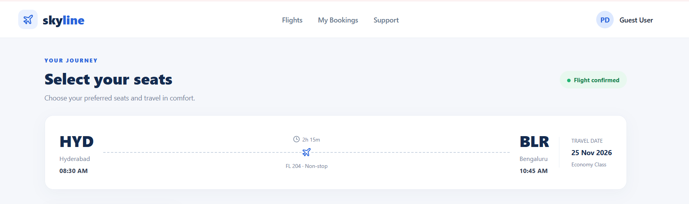
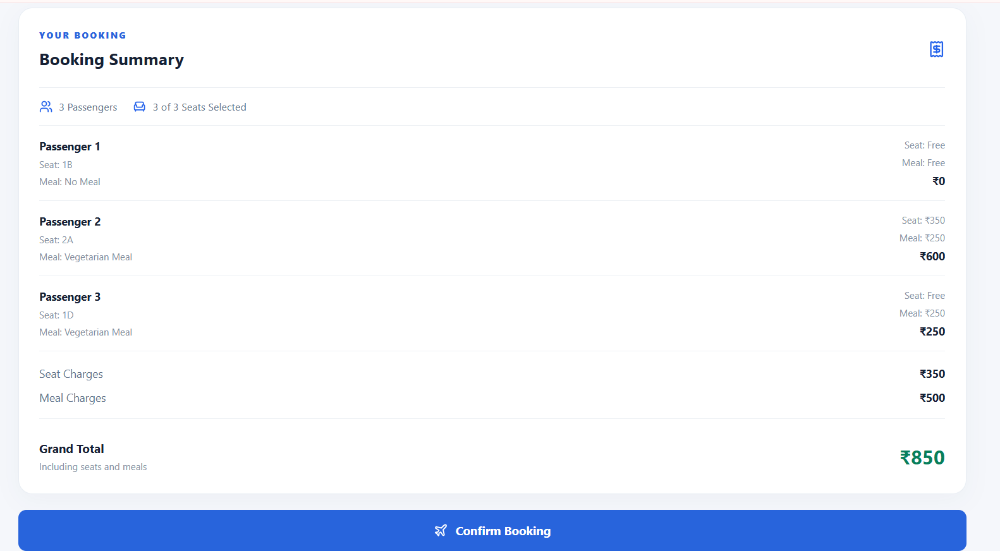
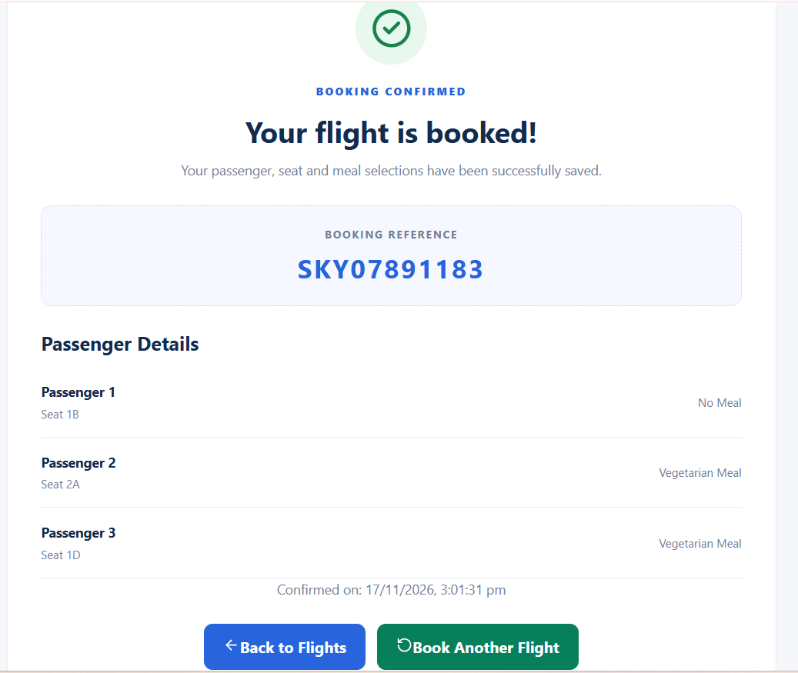

# Flight Seat Selection & Passenger Management

A modern, responsive flight seat selection application built with React.js and Vite. The application allows passengers to select seats, switch between aircraft seating configurations, manage passenger assignments, and view dynamically calculated seat-selection costs.

## Project Overview

This project demonstrates an interactive flight seat selection experience using mock flight and seat data with React state management.

It supports two aircraft seating configurations:
- 3–2 seating configuration
- 2–3–2 seating configuration

The application uses local state and does not require backend integration.

## Features

- Select the number of passengers.
- Dynamically generate the passenger list.
- Switch between passengers while retaining seat assignments.
- Support 3–2 and 2–3–2 aircraft layouts.
- Display row numbers and seat labels.
- Differentiate available, occupied, selected, and paid seats.
- Prevent selection of occupied seats.
- Prevent multiple passengers from selecting the same seat.
- Assign, change, and remove passenger seats.
- Display individual seat prices.
- Calculate the total seat-selection cost dynamically.
- Display a booking summary.
- Generate a mock booking confirmation.
- Responsive interface for different screen sizes.

## Technology Stack

- React.js
- Vite
- JavaScript
- CSS3
- Lucide React
- React Hooks (`useState`)

## Application Screenshots

### Main Interface



### 3–2 Aircraft Configuration


### 2–3–2 Aircraft Configuration


### Passenger Management


### Booking Summary and Pricing



### Booking Confirmation



## State Management and Seat Assignment Logic

The application uses React's `useState` hook through a custom `useSeatSelection` hook to manage passenger and seat-selection data.

### Passenger Management

- Passenger information is maintained in React state.
- Each passenger has a unique identifier.
- The currently active passenger is tracked using `activePassengerId`.
- Switching passengers displays their existing seat assignment.

### Seat Assignment

- Seat assignments are stored using passenger identifiers.
- When a passenger selects an available seat, the assignment is updated.
- The application prevents two passengers from being assigned the same seat.
- Occupied seats cannot be selected.
- Existing assignments can be changed or removed.

### Aircraft Configuration

The seat map supports two configurations:

- 3–2: A, B, C | D, E
- 2–3–2: A, B | D, E, F | G, H

When switching configurations, assignments to seats unavailable in the new layout are cleared.

### Seat Pricing

Seat prices are determined using mock seat data and pricing categories.

The booking summary calculates the total cost from the passengers' selected seats. The displayed amount updates when seat assignments change or are removed.

## Project Structure

```text
flight-seat-selection/
├── public/
│   └── screenshots/
├── src/
│   ├── components/
│   │   ├── Header.jsx
│   │   ├── FlightInfo.jsx
│   │   ├── SeatMap.jsx
│   │   ├── PassengerList.jsx
│   │   ├── BookingSummary.jsx
│   │   └── MealSelection.jsx
│   ├── data/
│   │   └── seats.js
│   ├── hooks/
│   │   └── useSeatSelection.js
│   ├── App.jsx
│   ├── App.css
│   ├── index.css
│   └── main.jsx
├── index.html
├── package.json
└── README.md
```

## Installation and Setup

### Prerequisites

- Node.js
- npm
- Git

### Clone the repository

```bash
git clone YOUR_GITHUB_REPOSITORY_URL
```

### Navigate to the project directory

```bash
cd flight-seat-selection
```

### Install dependencies

```bash
npm install
```

### Start the development server

```bash
npm run dev
```

Open the local URL displayed in the terminal.

### Create a production build

```bash
npm run build
```

## Live Demo

**Live Application:** Add your Vercel deployment URL here.

## Repository

**GitHub:** Add your GitHub repository URL here.

## Project Notes

- Uses mock flight and seat data.
- Passenger and seat information is managed locally.
- No backend, database, authentication, or real payment integration is required.
- Booking confirmation is for demonstration purposes only.
